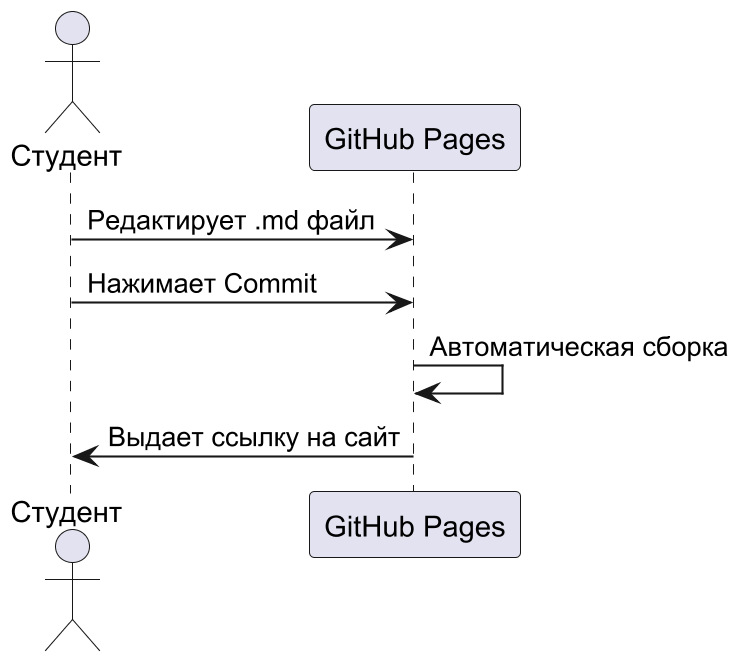

<!doctype html>
<html lang="ru">
<head>
<meta charset="utf-8">
<meta name="viewport" content="width=device-width, initial-scale=1">
<title>01. Введение — docs-automation-study</title>
<meta name="description" content="Учебная документация по практической работе 3.4: Docs-as-Code, GitHub Pages, PlantUML, OpenAPI.">
<link rel="stylesheet" href="../assets/style.css">
</head>
<body>
<header class="site-header">
  

    <a class="brand" href="../index.html">DS docs-automation-study</a>
    <nav class="top-nav">
      <a href="../index.html">Главная</a>
      <a href="../docs/01_intro.html">Введение</a>
      <a href="../docs/02_api.html">API</a>
      <a href="../docs/03_report.html">Отчёт</a>
      <a href="../api/index.html">Swagger UI</a>
    </nav>
  

</header>

  <aside class="sidebar">
    <h2>Документация</h2>
    <nav>
      <a href="../index.html" class="">Главная</a>
      <a href="../docs/01_intro.html" class="active">01. Введение</a>
      <a href="../docs/02_api.html" class="">02. Описание API</a>
      <a href="../docs/03_report.html" class="">03. Отчёт о работе</a>
      <a href="../api/index.html">Swagger UI</a>
    </nav>
    

      Практическая работа 3.4 
      Docs-as-Code  
      main
    

  </aside>
  <main class="content">
<h1 id="_1">Введение</h1>

Это моя первая автоматизированная документация.

<h2 id="_2">Цель</h2>
<ul>
<li>Изучить инструменты автоматизации.</li>
<li>Навести порядок в файлах.</li>
<li>Освоить публикацию документации как сайта.</li>
</ul>

<strong>Важно:</strong> документация — это <strong>часть кода</strong>, а не набор разрозненных файлов.

<h2 id="_3">Схема процесса</h2>

На рисунке показан конвейер публикации: редактирование Markdown-файла, 
коммит, автоматическая сборка и выдача ссылки на сайт.

Схема построена из текстового описания PlantUML, поэтому её можно 
изменить вместе с документацией и сохранить в истории Git.

  </main>

<footer class="site-footer">
  
© 2026 Карнилов Д. Е., группа ИСП-241/9. Учебный проект по автоматизации технической документации.

</footer>
</body>
</html>
